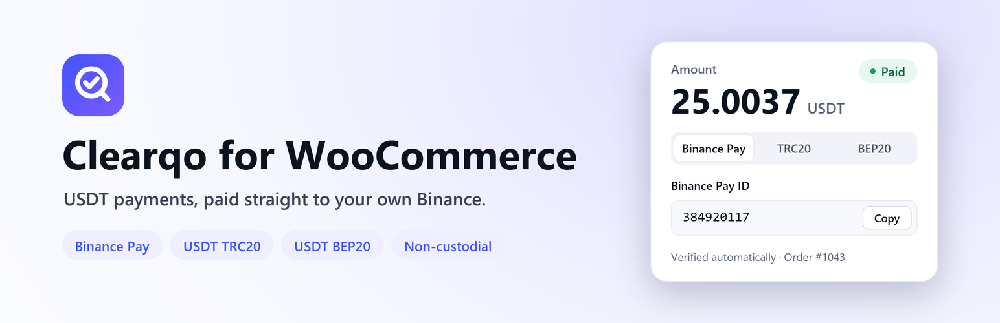
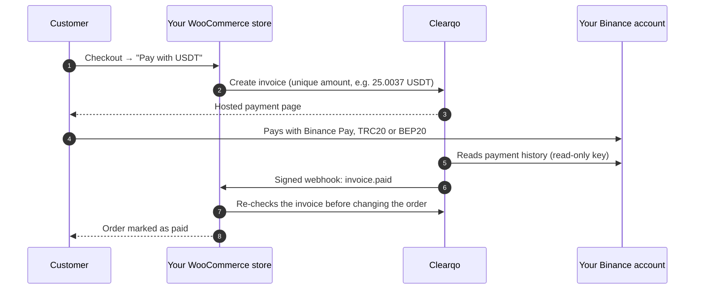
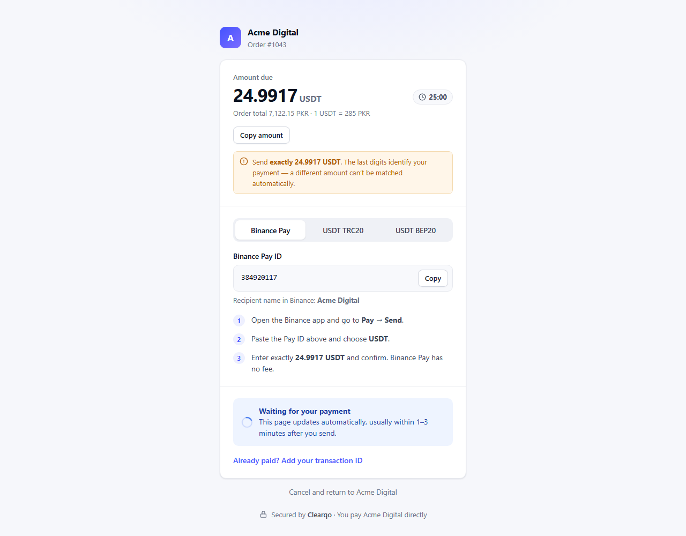
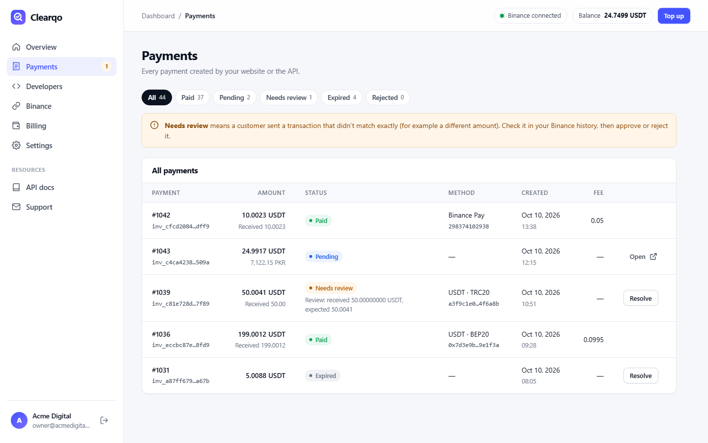
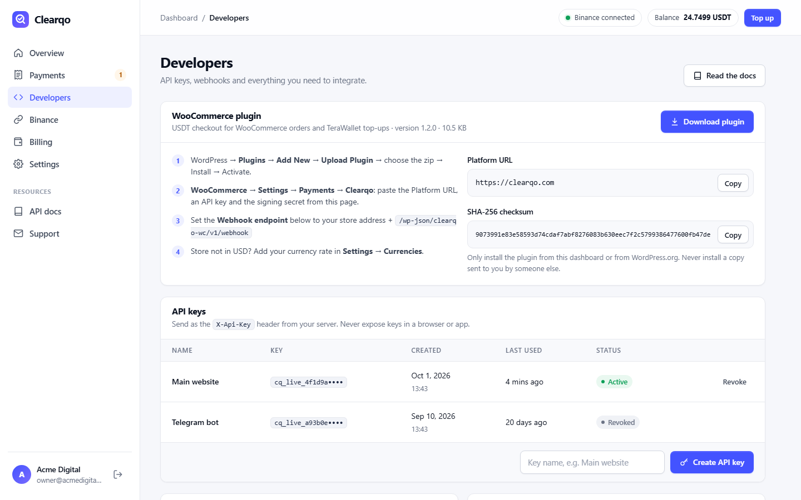
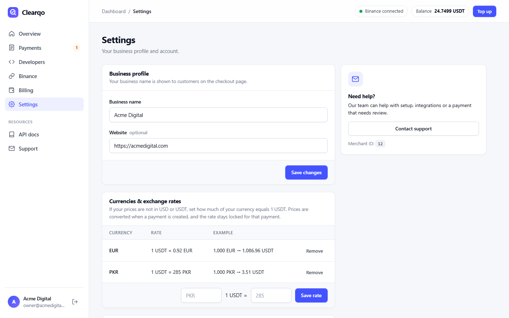

<p align="center">
  <a href="https://clearqo.com/woocommerce/"></a>
</p>

<h1 align="center">Clearqo for WooCommerce</h1>

<p align="center">
  <b>Non-custodial USDT payment gateway for WooCommerce — Binance Pay, USDT TRC20 and USDT BEP20.</b><br>
  Customers pay straight into <b>your own Binance account</b>. Every payment is verified automatically.
</p>

<p align="center">
  <a href="https://github.com/NoobSaifii/clearqo-for-woocommerce/actions/workflows/ci.yml"></a>
  <a href="https://github.com/NoobSaifii/clearqo-for-woocommerce/releases/latest"></a>
  
  
  
  <a href="LICENSE"></a>
</p>

<p align="center">
  <a href="https://clearqo.com/woocommerce/"><b>Website</b></a> ·
  <a href="https://github.com/NoobSaifii/clearqo-for-woocommerce/releases/latest"><b>Download</b></a> ·
  <a href="https://clearqo.com/developers/#woocommerce"><b>Setup guide</b></a> ·
  <a href="https://clearqo.com/developers/"><b>API docs</b></a> ·
  <a href="https://clearqo.com/merchant/?view=register&amp;ref=github"><b>Create a free account</b></a>
</p>

---

## Why Clearqo?

Most crypto payment gateways hold your money first and pay you out later. **Clearqo doesn't.** Customers pay directly into your own Binance account, and Clearqo only *reads* your payment history through a **read-only API key** to confirm each payment. Then it marks the WooCommerce order as paid.

- **No middleman, no payout delays.** The money is in your Binance the moment the customer pays.
- **No manual checking.** No screenshots and no hunting for transaction hashes.
- **No custody risk.** Clearqo refuses any API key that can withdraw, trade or transfer.

## Features

| | |
|---|---|
| 💸 **Binance Pay, TRC20 & BEP20** | Three ways to pay in USDT. Binance Pay has no network fee and confirms in seconds. |
| 🔒 **Non-custodial** | Payments go straight to your Binance. Clearqo can see incoming payments but can never move funds. |
| ⚡ **Orders complete automatically** | Each order gets a unique amount (e.g. `25.0037 USDT`), so every payment matches exactly one order, usually within a minute. |
| 🌍 **Any store currency** | Sell in USD, EUR, PKR, INR, NGN… You set your own exchange rate, and it is locked for each order. |
| 👛 **TeraWallet top-ups** | Customers can top up their wallet balance with USDT and are credited exactly what they paid. |
| 🧱 **Modern WooCommerce** | Works with the Cart & Checkout **blocks**, the classic checkout and **HPOS** (High-Performance Order Storage). |
| 🛡️ **Secure by design** | HMAC-signed webhooks, server-side re-verification, a per-order lock against double credits, and on-hold for under-payments. |
| 🌐 **Translation-ready** | Every string uses the `clearqo-for-woocommerce` text domain. |

## How it works



## Screenshots

| Hosted payment page | Payments dashboard |
|---|---|
|  |  |
| **Plugin download, API keys & webhooks** | **Your own exchange rates** |
|  |  |

## Requirements

- WordPress **6.5+**
- WooCommerce **8.0+** (tested up to 11.2)
- PHP **7.4+**
- A free [Clearqo account](https://clearqo.com/merchant/?view=register&ref=github) and a Binance account

## Installation

1. Download **`clearqo-for-woocommerce.zip`** from the [latest release](https://github.com/NoobSaifii/clearqo-for-woocommerce/releases/latest). You can also download it from your Clearqo dashboard under **Developers**.
2. In WordPress go to **Plugins → Add New → Upload Plugin**, choose the zip, then click **Install Now** and **Activate**.
3. In your [Clearqo dashboard](https://clearqo.com/merchant/?ref=github), connect a **read-only** Binance API key (**Binance** tab) and add your Binance Pay ID and/or USDT addresses.
4. Under **Developers**, create an API key and copy your webhook signing secret.
5. In WordPress open **WooCommerce → Settings → Payments → Clearqo (USDT)**. Paste the API key and signing secret, then enable the method.
6. In Clearqo set the webhook endpoint to:
   ```
   https://your-store.com/wp-json/clearqo-wc/v1/webhook
   ```
7. Store not priced in USD? Add your rate in **Clearqo → Settings → Currencies** (for example `1 USDT = 285 PKR`).

> [!TIP]
> Selling TeraWallet top-ups in a USD store? Set **WooCommerce → Settings → General → Number of decimals** to **4**, so an amount like `10.0023` is credited in full.

## Configuration

| Setting | Description |
|---|---|
| **Platform URL** | `https://clearqo.com` (https only) |
| **API key** | From Clearqo → Developers → *Create API key* |
| **Webhook signing secret** | From Clearqo → Developers |
| **Title / Description** | What customers see at checkout |

Prefer to keep secrets out of the database? Define them in `wp-config.php`. Constants always override the settings screen:

```php
define( 'CLEARQO_API_BASE', 'https://clearqo.com' );
define( 'CLEARQO_API_KEY', 'cq_live_…' );
define( 'CLEARQO_WEBHOOK_SECRET', 'whsec_…' );
```

## Security

- **Read-only keys only.** Binance keys with withdraw, trade or transfer permission are refused, and keys must be IP-restricted.
- **Signed webhooks.** `X-Clearqo-Signature` is an HMAC-SHA256 with a timestamp, so stale or forged requests are rejected.
- **Never trusts the webhook body for money.** The plugin always re-fetches the invoice from the API before changing an order.
- **No double credits.** Each order is locked while a confirmation is applied, and TeraWallet is never credited more than was paid.
- **Safe failure.** Under-payments and currency mismatches put the order on hold instead of completing it.

Found a vulnerability? Please report it privately. See [SECURITY.md](SECURITY.md).

## FAQ

<details>
<summary><b>Does Clearqo hold my money?</b></summary>

No. Customers pay straight into your own Binance account. Clearqo only reads your payment history with a read-only API key, so it can never move your funds.
</details>

<details>
<summary><b>Which payment methods can customers use?</b></summary>

Binance Pay, USDT on TRON (TRC20) and USDT on BNB Smart Chain (BEP20).
</details>

<details>
<summary><b>My store is priced in PKR, EUR or INR. Can customers still pay in USDT?</b></summary>

Yes. Set your own rate in the Clearqo dashboard. The order total is converted to USDT at checkout, rounded up so you never receive less, and the rate is locked for that order.
</details>

<details>
<summary><b>What if a customer sends the wrong amount?</b></summary>

The payment is flagged as **Needs review** in your Clearqo dashboard and the order is put on hold. You approve or reject it with one click.
</details>

<details>
<summary><b>Is the plugin free?</b></summary>

Yes. The plugin is free and open source (GPL). Creating a Clearqo account is free. Clearqo charges a small fee per confirmed payment from a prepaid balance, with no monthly fees. See [pricing](https://clearqo.com/#pricing).
</details>

<details>
<summary><b>Can I use Clearqo without WooCommerce?</b></summary>

Yes. Clearqo has a REST API and signed webhooks for any website, app or bot. See the [API documentation](https://clearqo.com/developers/).
</details>

## External services & privacy

This plugin connects to the **Clearqo API** (`https://clearqo.com`), which is required to verify payments.

- **When:** when a customer places an order with the USDT method; when the thank-you page or the hourly background check looks up an unpaid order; and when you save the settings (connection test).
- **What is sent:** order total and currency, order ID and number, store name, the customer's billing email, your store's return URLs, and your Clearqo API key (for authentication). Card data and passwords are never sent.

[Terms of Service](https://clearqo.com/terms/) · [Privacy Policy](https://clearqo.com/privacy/)

## Development

```
clearqo-for-woocommerce/
├── clearqo-for-woocommerce.php   # Gateway, webhook, order confirmation, TeraWallet safety net
├── assets/blocks.js              # Checkout block integration (plain JS, no build step)
├── readme.txt                    # WordPress.org readme
└── LICENSE
```

Every push runs [CI](.github/workflows/ci.yml): a PHP syntax check on PHP 7.4 → 8.5, JavaScript and version-consistency checks, and the official [WordPress Plugin Check](https://github.com/WordPress/plugin-check-action).

Build the installable zip (development files are excluded through `.gitattributes`):

```bash
git archive --format=zip --prefix=clearqo-for-woocommerce/ -o clearqo-for-woocommerce.zip HEAD
```

Contributions are welcome. See [CONTRIBUTING.md](CONTRIBUTING.md). The full history is in [CHANGELOG.md](CHANGELOG.md).

## Support

- 🌐 Website: **[clearqo.com](https://clearqo.com/)**
- 📘 Docs: [clearqo.com/developers](https://clearqo.com/developers/)
- ✉️ Email: [support@clearqo.com](mailto:support@clearqo.com)
- 🐞 Bugs & feature requests: [GitHub Issues](https://github.com/NoobSaifii/clearqo-for-woocommerce/issues)

## License

[GPL-2.0-or-later](LICENSE). Clearqo is an independent service and is not affiliated with, endorsed by or sponsored by Binance. Binance and Binance Pay are trademarks of their respective owners.
